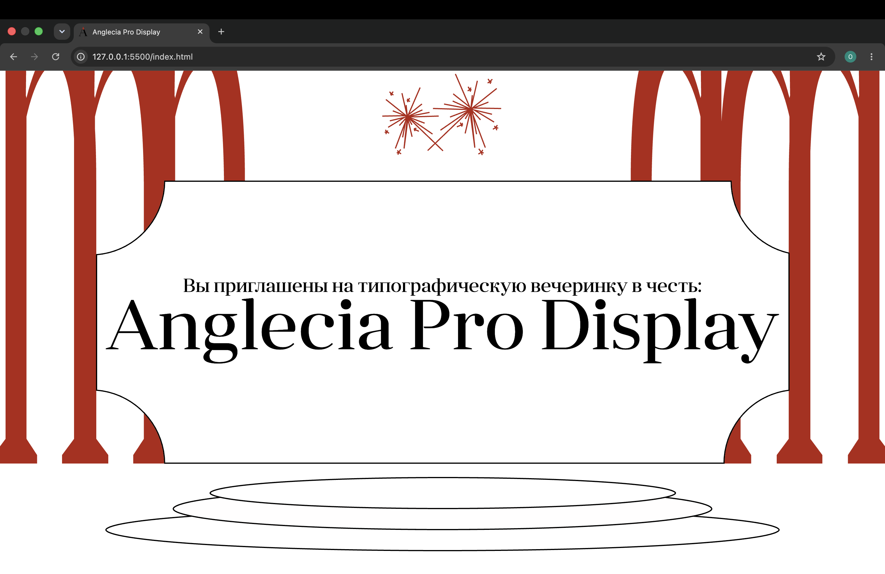

```markdown
# [Anglecia Pro Display]

[Сайт о шрифте]

## Ссылка на сайт

[https://github.com/leliksyr/Anglecia-Pro-Display]

## Скриншот



## Автор

[Ольга Ясыр, b26d309]

## Что я научился(ась) делать

- [сверстать полностью сайт]
- [Сначала было трудно разбираться с расположением текста, потом рзобралась]
- [Узнала как верстать сайт на html и css]

## Использование ИИ

### Инструменты

| chat.gpt | Для создания анимации | 3 |
| chat.gpt | Понять в чем ошибка, почему был сильный отступ меежду section | 1 |
| [ ] | [ ] | [ ] |

### Записи о запросах

#### Запись №1 · [26.10.2026]

- **Сделать эффект падающих конфети (у меня уже были созданы дивы с кружочками, нужна была только анимация)** [ ]
- **я хочу сделать анимацию падающих круглых конфети на этих экранах в css** [ ]
- \*_Дал код для css:
  /_ Области с конфетти \*/
  .content2,
  .section-5 {
  position: relative;
  overflow: hidden;
  }

/_ Общий стиль кружков _/
.bubble {
position: absolute;
top: -40px;
width: 25px;
height: 25px;
border-radius: 50%;
z-index: 10;
pointer-events: none;
animation: bubble-fall 9s linear infinite;
}

/_ Цвета _/
.bubble--blue {
background-color: #cff1fa;
}

.bubble--pink {
background-color: #fad4cf;
}

/_ Разное расположение и скорость _/
.bubble:nth-of-type(1) {
left: 10%;
animation-duration: 8s;
animation-delay: -2s;
}

.bubble:nth-of-type(2) {
left: 27%;
animation-duration: 11s;
animation-delay: -6s;
}

.bubble:nth-of-type(3) {
left: 43%;
animation-duration: 9s;
animation-delay: -4s;
}

.bubble:nth-of-type(4) {
left: 62%;
animation-duration: 12s;
animation-delay: -8s;
}

.bubble:nth-of-type(5) {
left: 78%;
animation-duration: 10s;
animation-delay: -3s;
}

.bubble:nth-of-type(6) {
left: 92%;
animation-duration: 7s;
animation-delay: -5s;
}

/_ Анимация падения _/
@keyframes bubble-fall {
0% {
top: -40px;
transform: translateX(0);
}

50% {
transform: translateX(30px);
}

100% {
top: 100%;
transform: translateX(-20px);
}
}
\*\* [ ]

- **Меняла прозрачность кружков** [ ]
- **Как я понял(а), что это работает:зашла на свой сайт и проверила как работает** [ ]

#### Запись №2 · [26.10.2026]

- **{Хотела понять почему большой отступ}** [ ]
- **почему тут большой белый разрыв** [ ]
- \*Судя по твоему CSS, большой белый разрыв, скорее всего, появляется из-за position: relative и отрицательного top у текста с алфавитом в третьей секции.Как исправить
  Попробуй добавить в .america всего одну строчку:margin-bottom: -682px компенсирует пустое пространство, оставшееся после перемещения текста.
  \*\* [ ]

- **Сделала то, что он сказал** [ ]
- **Как я понял(а), что это работает:зашла на свой сайт и проверила как работает** [ ]

### Выводы

[Все хорошо помог, не было никаких проблем. Теперь могу создавать такие анимации и понимаю в чем может быть проблема при большом разрыве.]
```

Если ИИ вы не использовали совсем, в разделе «Использование ИИ» так и напишите: `ИИ при работе над проектом не использовался.`
